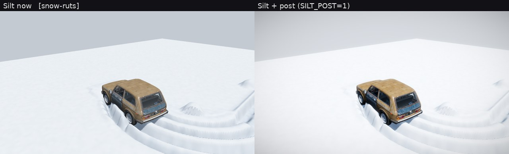
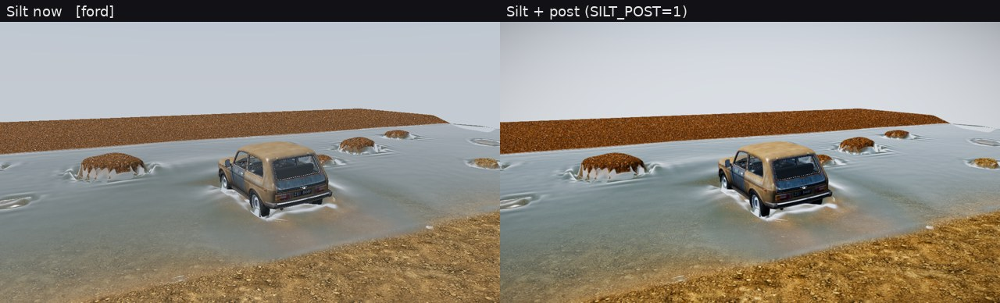
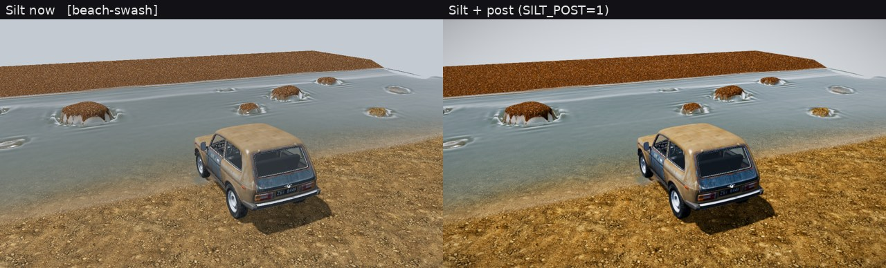
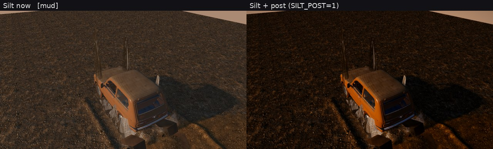
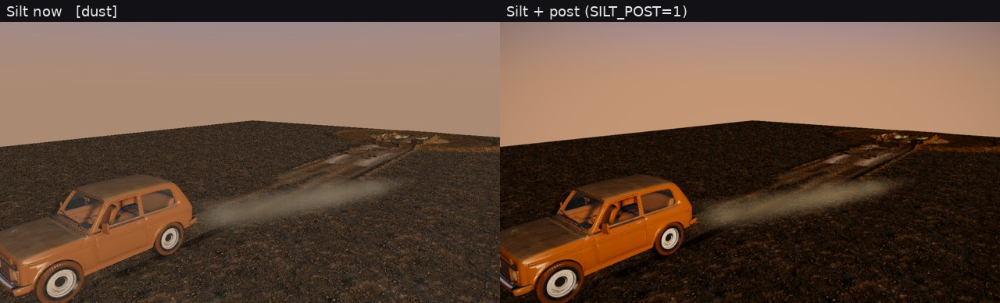
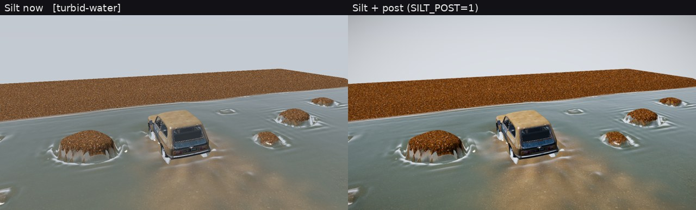

# Look gap: why the UE5 + FluidNinja frames look better, and what to do

Status 2026-11-01. Inputs: the UE5 bench (`docs/UE5_BENCH.md`, 13 scenes, Silt
on main 0f936de vs Vitalii's UE5/FluidNinja references), the beauty stills of
PR #60, the shader on main (`src/shader.wgsl`, `src/render.rs`) and public
Epic / FluidNinja documentation. The UE5 screenshots stay out of this public
repo; the side-by-sides with them are in the project files (`look-gap/`).

## Short answer

1. **The gap is rendering, not simulation.** FluidNinja is a 2D grid fluid
   sim whose output is a few textures (density, velocity). The look comes
   from what UE5 does with those textures: flow-mapped detail normals on
   materials, Niagara particles pushed by the velocity field, heterogeneous
   volumes for smoke and dust, and then UE5's lighting and post stack. Our
   solver already publishes richer maps than that (render contract v11:
   depth, flow, foam, turbidity, ruts, moisture, crust, snow, air).
2. **Post-processing alone is not the lever.** The prototype in this PR
   (ACES curve, bloom, edge AA, grade) was measured on all 13 bench scenes.
   It cleans up the image (contrast, colour separation, no stair edges on
   the Niva), but in my reading no scene moves more than about half a point
   on the bench's 1–5 scale. See the frames below.
3. **What carries the UE5 frames, ranked by what we see in the bench:**
   material micro-detail, water shading, sky + ambient light + environment,
   contact shadows / AO. Post and AA come after those.
4. **Part of the gap is already closed on a branch.** PR #60 (beauty) has an
   HDRI sky used as IBL and water Fresnel, SSR, planar reflection and near
   shadows. None of it is on main, so the bench does not show it. Compare
   `beauty-proof/37-puddle-niva.jpg` (PR #60, HDRI sky) with any bench frame
   (two-colour gradient sky).
5. **Two gaps are physics, not rendering:** dust is a thin trail where UE5
   shows a dense cloud, and snow has one rut arc with smooth berms where UE5
   has many overlapping tracks and footprints. The rendering plan below does
   not fix those; the route-scoring thread tracks them.

## How the UE5 frames are made (public sources)

| Effect in the refs | UE5 / FluidNinja technique |
| --- | --- |
| Water surface detail (ue5-103, -104) | FluidNinja velocity texture used as a flow map: two phase-shifted samples of a tiling normal map, cross-faded (Valve, "Water Flow in Portal 2", 2010). The sim grid itself is coarse. |
| Sun glints on shallows (ue5-98) | GGX specular of the sun on a high-frequency normal, values far above 1.0 in an HDR buffer, then bloom. Needs HDR; an 8-bit buffer clips them. |
| Clear shallows over sand (ue5-98, -99) | Single-layer water shading: depth-based absorption, refraction of the scene colour behind the surface, caustics. |
| Snow look (ue5-96, -97) | Deformation in a render target (ruts, prints) + tessellation/Nanite displacement, a detailed snow normal map with sparkle, blue skylight in the shadows (Lumen GI + sky light). |
| Mud (ue5-105, video) | Megascans-style ground with height-blended wet layer: dark albedo, low roughness, strong normal detail; specular picks up the sky. |
| Dust and smoke (ue5-93, -89) | FluidNinja density/velocity drive heterogeneous volumes or Niagara sprite clouds; lit by the directional light with self-shadow; motion blur and DOF on top. |
| Overall tone | Filmic tone mapper (ACES-based), auto exposure, bloom, colour grading, TSR. |

Lumen costs about 4 ms at 1080p on current consoles at 60 FPS (Epic's Lumen
performance guide). A GTX 1660 is slower and has no hardware ray tracing, so
Lumen is not an option for our medium preset. Everything below is a
rasterised approximation that fits our 12 ms GPU budget.

## Layer by layer

Impact is judged from the 13 bench scenes: how much of the visible
difference to the reference the layer explains. 1660 costs are estimates at
1080p from comparable published implementations, not measurements: there is
no GPU in the cloud or CI. They must be confirmed with `scripts/bench.sh`.

| # | Layer | What UE5 does | What we have (main) | Impact | GTX 1660 cost | Open-source base |
| ---: | --- | --- | --- | --- | --- | --- |
| 1 | Materials / textures | Megascans scans; detail normal + roughness at 2–3 scales; height-blended layers; snow sparkle | Albedo textures on ground, no detail normals; snow is flat white; wet look is a tint | **Highest.** Snow, mud and sand frames are flat next to the refs | 0.3–0.5 ms in `main` (2–3 extra fetches per terrain pixel); +64–128 MiB textures | CC0 Poly Haven / ambientCG (already listed in beauty base); height blend: Zylann godot_heightmap_plugin (MIT), jensnt TerrainHeightBlend (MIT); wet: Lagarde "Physically based wet surfaces" (technique) |
| 2 | Fluid shading | Flow-mapped normal detail, absorption, refraction, caustics, foam textures, sun glints | Mostly opaque tinted surface with gradient-sky reflection; contract turbidity/foam/flow tint and one flow-advected silt/foam layer, but no flow-advected normal detail, refraction or caustics on main | **High.** Ford, beach, river, turbid scenes | 0.3–0.6 ms in `water` (fits the 1.2 ms row) | bevy_water (MIT/Apache), wgpu `water` example (MIT/Apache), URP-WaterShaders (MIT), three.js Water2 flow map (MIT) |
| 3 | Lighting, sky, environment | Physical sky + sky light; Lumen GI; distant terrain | Two-colour gradient sky, constant ambient tint, the world is a slab in a grey void | **High.** Every frame. PR #60 already proves the HDRI part | Sky LUTs ~0.1 ms; SH ambient from HDRI ~0; backdrop mesh ~0.1 ms | Bevy 0.16 `atmosphere` (Hillaire 2020, MIT/Apache); HDRI from Poly Haven (CC0, already in #60); SH projection: glTF-Sample-Viewer (Apache) |
| 4 | Shadows / AO | Virtual shadow maps, contact shadows, Lumen AO | One 2048 map, 3×3 PCF, depth packed in RGBA8; no AO | **Medium-high.** Car looks pasted on the ground; ruts read flat | GTAO half-res 0.4–0.6 ms; 2 cascades +0.3 ms | Bevy 0.16 `ssao` (GTAO, MIT/Apache); PCSS in bevy_pbr |
| 5 | Post-processing | Filmic curve, auto exposure, bloom, grading, vignette | `present()` per shader: `1-exp(-1.08c)` + gamma, written to RGBA8. No HDR buffer, bloom or grade | **Medium.** Measured with the prototype: cleaner, never decisive | Prototype: ~0.3 ms (1 full-res + 3 quarter-res passes). With an `Rgba16Float` scene target +0.1–0.2 ms bandwidth | This PR (own code; ACES fit from MJP BakingLab, MIT); Bevy `tonemapping` (AgX/TonyMcMapface, MIT/Apache); Khronos PBR Neutral (Apache) |
| 6 | Camera / AA | TSR (temporal upscaler), motion blur, DOF in cinematics | No AA at all; render scale 0.75 on low with a bilinear upsample | **Medium.** Stair edges on the Niva and rut walls; noisy SSR/volume | FXAA ~0.15 ms (in the prototype); TAA ~0.2 ms; FSR 1 ~0.2 ms | Bevy `taa` (MIT/Apache); SMAA (iryoku, MIT); AMD FSR 1 (MIT) |
| 7 | Particles / spray | Niagara GPU sprites driven by the sim velocity; soft particles, lit | CPU particles up to 12k, unlit sprites | Medium-low in stills, higher in motion | ~0.3–0.5 ms in `after-water` | bevy_hanabi (MIT/Apache) for the GPU sim pattern; soft particles from scene depth |
| 8 | Reflections | Lumen reflections, SSR fallback | Sky colour only on main; SSR + planar in PR #60 | Low-medium once #60 lands | 0.8 ms (already budgeted as `water-ssr`) | Bevy `ssr` (MIT/Apache), already ported in #60 |

The volumetric dust pass (`dust-volume`, 2.4 ms) is already in the budget
and works; the dust gap is density from the solver, not the renderer.

## The post-processing prototype (this PR)

`SILT_POST=1` turns it on; it is off by default so no golden frame or still
changes. `src/post.rs` + `src/post.wgsl`:

1. Undo the in-shader `exp` curve to get approximate linear HDR back (up to
   ~5.8; the 8-bit round trip limits highlights, which is why thread 1 moves
   to a float target).
2. Bloom: soft threshold, 13-tap downsample to 1/4 resolution, separable
   9-tap blur. Off on `low`.
3. Edge AA (FXAA idea) with a light unsharp mask on non-edges.
4. Exposure, bloom, ACES fitted curve, saturation, contrast, cool shadows,
   vignette.

Silt before (left) and with the stack (right), same bench cameras:

What it shows: sand and the Niva gain colour and depth, the sky is no longer
a flat grey slab, edges are clean. What it does not do: the snow is still
flat white, the water still has no detail or glints (there are no HDR
highlights to bloom), the mud is still a texture without relief. That is
layers 1–3, not layer 5.

## Route scoring cross-check (PR #147, docs/ROUTE.md)

The full-route scoring thread found these rendering-led failures. Each one
maps to a thread below:

| Route finding | Layer | Thread |
| --- | --- | --- |
| Spray and slurry drawn as tall vertical cards over the roof, dark rectangular slabs at the wheels (worst on the route) | Particles | 3 (water v2) takes spray: soft, camera-facing, lit sprites with depth fade; slabs need a look at chunk meshes |
| Flat grey-blue water, no sun glints, no foam lines on the swash | Fluid shading + HDR | 1 (HDR for glints) and 3 |
| White jagged fringes around river rocks at the waterline | Fluid shading | 3 (depth-fade foam instead of the hard edge band) |
| Snow: ruts vanish when backlit, no sparkle, no blue shadow | AO + materials | 2 (sparkle, detail normal) and 4 (GTAO, sky fill) |
| Mud without wet gloss | Materials | 2 (Lagarde wet model from contract moisture) |

This moves particles/spray up from medium-low: in motion along the route it
is the most visible defect. Open question from that thread: whether the
dusk puddle fails because of sheet depth or water shading.

## Free assets and tools (Vitalii, 2026-11-01)

Every thread starts from existing free material, not from scratch, and
records each source with its licence (and commit, for code) in
`THIRD_PARTY.md`:

* **Textures (CC0):** Poly Haven and ambientCG scanned PBR sets (albedo,
  normal, roughness, height): snow, mud, sand, gravel, clay, cracked ground,
  wet puddle. Height maps are what the seam height blend and parallax need.
* **Sky:** Poly Haven HDRIs (CC0) for IBL and backdrop, matched to each
  scene's sun.
* **Shader code (MIT/Apache):** Bevy 0.16 `bevy_pbr` / `bevy_core_pipeline`
  (atmosphere, GTAO, TAA, SSR, tonemapping, volumetric fog), bevy_water,
  wgpu examples, bevy_hanabi, AMD FidelityFX CAS / FSR 1, SMAA.
* **Generative (Kling):** used for target-look concept frames per scene
  and for detail textures only where no CC0 scan exists. Such a texture
  gets a normal/height map derived from it and is marked as generated in
  `THIRD_PARTY.md`.
* Still excluded: Shadertoy (CC BY-NC-SA) and Unity BoatAttack code.

## Plan: work threads, in order

The GPU frame budget stays 12 ms on the reference card (`docs/GPU_BUDGET.md`).
The table there already sums to 11.7–11.9 ms, so each thread names what pays
for its cost.

1. **HDR pipeline + land the beauty base.** One `Rgba16Float` scene target;
   scene shaders output linear light; the tone curve, bloom and grade run
   once (this prototype, moved from the 8-bit round trip). Bring PR #60's
   HDRI sky, IBL and SSR to main through a normal merge PR (Vitalii's OK).
   Pays for itself: `post` replaces `blit` (0.3 ms) in the window.
2. **Surface detail materials** (snow, sand, mud, clay, gravel). CC0 detail
   normal + roughness at two scales, height blend at soil seams, snow sparkle
   and blue-sky fill in shadow, Lagarde wet model driven by contract
   moisture. All placement from contract maps, nothing hand-shaped. Cost
   inside the `main` row (0.3–0.5 ms on medium), paid by CDLOD #120 cutting
   terrain triangles.
3. **Water shading v2.** Two-phase flow-mapped normals from contract flow,
   depth absorption and refraction of the scene behind the surface,
   caustics on the bed, foam texture from the foam map, sun glints into the
   HDR buffer (bloom then does the rest). Inside the `water` row.
4. **Contact light: GTAO + shadow cascades + sky ambient.** Half-res GTAO
   from Bevy, two cascades or the near map from #60, SH ambient from the
   HDRI. ~0.6–0.9 ms; paid by thread 5.
5. **Temporal AA.** Jitter + TAA from Bevy. It lets the volume, SSR and AO
   run at fewer steps with temporal accumulation (e.g. fog 24 → 12 steps on
   medium), which pays for thread 4.
6. **Backdrop** (optional, cheap, visible in every frame): distant terrain
   ring and horizon so scenes stop ending at a slab edge. Not physics.

Physics items that block a 4+ score regardless of rendering, for the
route-scoring thread: dust density/volume behind the car, overlapping snow
tracks and prints, river surface detail at the solver resolution.
